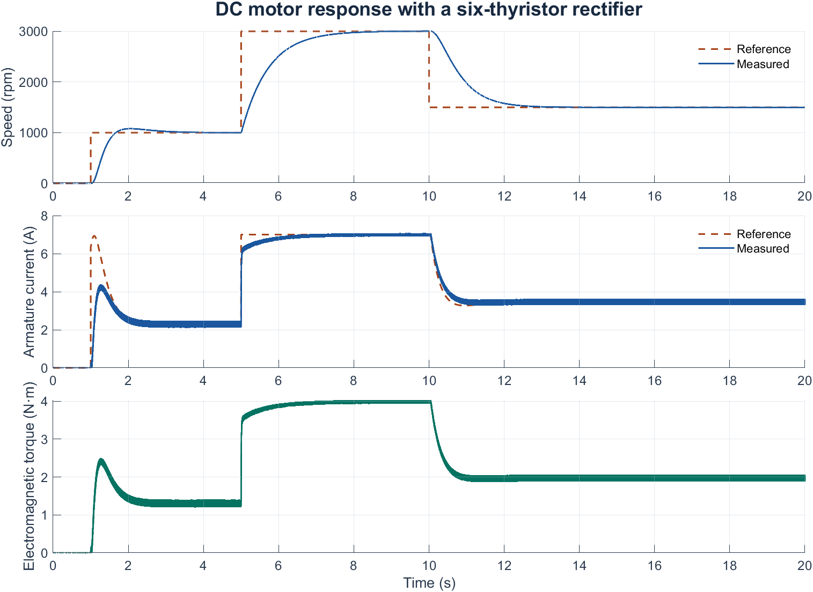
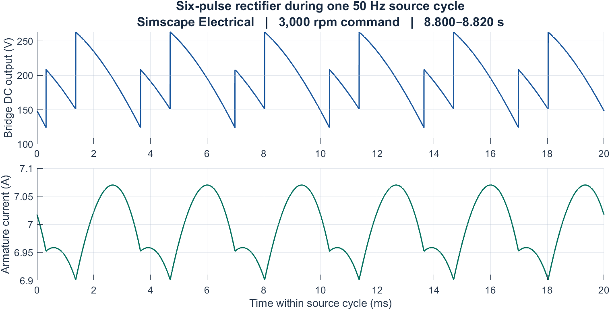

# DC motor cascade control

Cascade speed-and-current control of a separately-excited **DC machine** fed by a
**three-phase (6-pulse) thyristor rectifier**. An **outer speed loop** sets the
current reference for an **inner current loop**; the PI/PID gains are tuned
analytically from the machine's electrical and mechanical time constants.

Academic project carried out at **École Nationale Polytechnique (ENP), Algiers**.
The report covers the drive model, firing-angle law, controller tuning, and
simulation results. [English report](MATLAB/Report.pdf) · [Rapport en français](MATLAB/Report.fr.pdf)

## Two implementations

1. **Averaged Simulink block diagram.** Standard blocks implement the armature
   and shaft equations. A first-order transfer function represents the converter
   so the current PID and speed PI can be tuned from the model.
2. **Switched Simscape Electrical model.** A controlled voltage source was first
   used to check the library DC machine and its feedback signals. The final model
   replaces that source with a three-phase supply and a six-thyristor bridge.
   The inner PID drives the firing-angle generator, which supplies the
   synchronized gate-pulse block.

In the 20-second switched simulation, the reference steps to 1,000, 3,000 and
1,500 rpm. The measured speed peaks at 3,004.42 rpm and ends at 1,499.95 rpm.
The measured armature current peaks at 7.07 A with a 7 A reference limit.





The voltage trace is measured at the bridge DC output, upstream of the
276 mH smoothing inductor. The current trace shows the filtering effect of that
inductor. The [averaged-model response](MATLAB/assets/dc-motor-block-diagram-response.png)
uses its own speed-step timing and current-reference settings.

## Layout

| Folder | Contents |
|---|---|
| [`MATLAB/`](MATLAB/) | The MATLAB/Simulink work — setup scripts, the Simulink models, and the report. |
| [`Python/`](Python/) | An independent Python port that reproduces the tuning and generates the response figures. |

### MATLAB/

```
MATLAB/
├── Report.pdf           English report
├── Report.fr.pdf        French report
├── Main & Setup/        main.m, dc_machine_params.m, dc_tf_function.m
├── PID Block Diagram/   transfer-function block-diagram model (.slx)
├── Library/             SimPowerSystems model with the detailed thyristor rectifier (.slx)
├── Variants/            alternative SPS models kept for comparison
├── export_dc_motor_results.m
└── assets/              model diagrams and simulation results
```

Run:

1. Open `MATLAB/Main & Setup/main.m`, set `machine`, `target_armature_voltage`,
   `target_speed_rpm`.
2. Run it — it prints the tuned current/speed PI(D) gains and populates the
   workspace.
3. Open and run the matching `.slx` model.

To regenerate the three response figures, run this from the repository root
with both models closed.

```matlab
addpath('MATLAB');
export_dc_motor_results;
```

The figure exports were verified in MATLAB/Simulink R2024b with Control System
Toolbox and Simscape Electrical Specialized Power Systems.

### Python/

A NumPy/SciPy re-implementation that matches the MATLAB design exactly and produces
the closed-loop step-response figures. See [`Python/README.md`](Python/README.md).

```bash
cd Python
pip install -r requirements.txt
python dc_motor.py          # prints the design cross-check against MATLAB
python generate_figures.py  # regenerates the figures in results/
```
